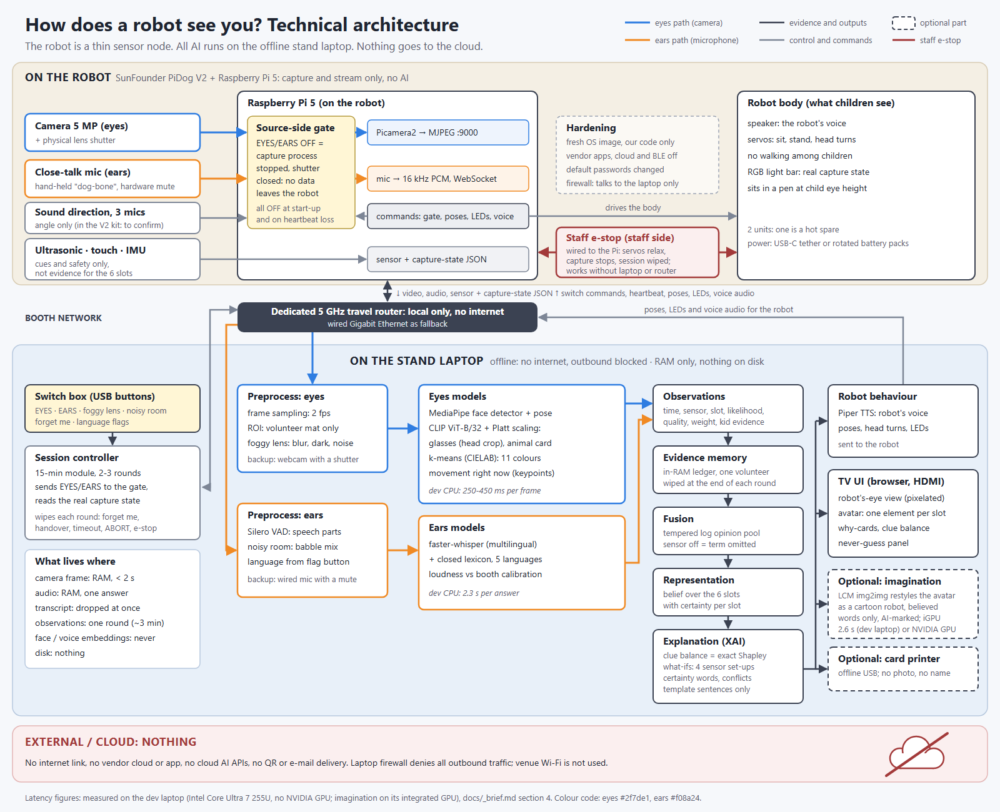
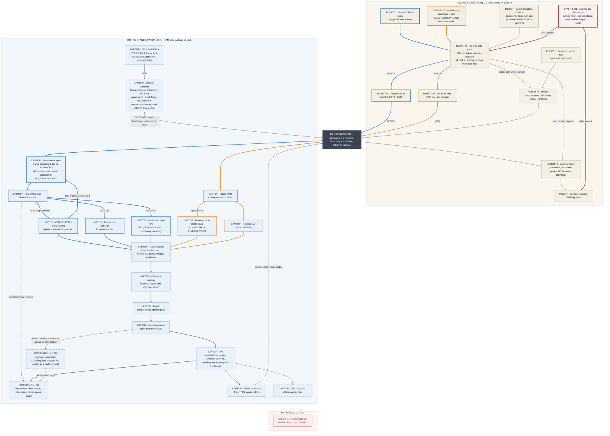

# Deliverable 2: Technical architecture

Purpose: show TUAI partners how the "How does a robot see you?" booth is built, what runs where and why, how data moves and is deleted, how fast it is, and what we do when parts fail.

## Key points

- **The robot is a thin sensor node.** The SunFounder PiDog V2 with a Raspberry Pi 5 captures and streams the camera, the close-talk mic and its low-rate sensors. It executes poses, LEDs and voice playback. It runs no AI.
- **All AI runs on one offline stand laptop.** That covers perception, the evidence memory, fusion, explainable AI (XAI), the TV UI, Piper text-to-speech (TTS) and the optional "imagination" image. The robot and laptop talk over a dedicated 5 GHz router with no internet. External or cloud: nothing.
- **The EYES and EARS switches act at the source.** In the exhibition design, "off" stops the capture process on the robot and the lens shutter closes, so no data leaves the robot. Fusion then drops that sensor's term exactly. The prototype's live mode does not do this yet: it reads a switched-off camera's frames and drops them before any model sees them (§1, Prototype status).
- **Data lifetime:** camera frames stay in RAM for under 2 s. Observations last one volunteer round (~3 min) and are wiped at its end, at handover, after an empty-mat timeout, on the staff ABORT key or on the e-stop (§4). Nothing is written to disk.
- **The dev laptop CPU already runs the core loop:** 250-450 ms per camera frame and 2.3 s per spoken answer. An NVIDIA GPU is not needed for the core loop. The optional imagination image takes 2.6 s on the dev laptop's integrated GPU (iGPU) via OpenVINO, 22-53 s on the CPU alone, and an estimated 1 s or less on a mid-range NVIDIA GPU.
- **Safety does not depend on the laptop.** A staff-side e-stop wired to the robot relaxes the servos and stops capture, and the robot fails closed when it loses the laptop's heartbeat (proposed, §1).
- **Chosen design: Option 2, distributed local.** Option 1 (everything on the robot) lacks compute. Option 3 (cloud) sends children's data out of the booth and depends on the venue Wi-Fi.
- **Every likely failure has a fallback** that keeps the 15-min group module running (§6).

---

## 1. Architecture diagram

The static diagram has three swim-lanes and uses the eyes/ears colour code (eyes `#2f7de1`, ears `#f08a24`); red marks the staff e-stop. Source: [assets/architecture.svg](assets/architecture.svg).

In the Mermaid version, each node is prefixed with where it runs. Blue edges are the eyes path, orange edges the ears path, grey edges are control and commands, red edges the staff e-stop, and dark edges the fused evidence and outputs. Dashed nodes are optional.

**The four flows:**

1. **Eyes.** Camera, gate, MJPEG, router. Then frame sampling and the region of interest (ROI), the volunteer mat. Then the models: MediaPipe face and pose; CLIP + Platt for glasses (on the head crop) and the animal card (on the ROI frame); k-means colour naming; and "movement right now" (body-keypoint speed, a momentary reading, never a trait). Output: observations.
2. **Ears.** Close-talk mic, gate, 16 kHz PCM, router. Then Silero voice activity detection (VAD). Then faster-whisper speech recognition (ASR) with the closed lexicon, plus loudness. Output: observations.
3. **Core.** Observations go into the in-RAM ledger, then fusion, then the belief over the 6 slots, then XAI. The XAI output feeds the TV UI and the robot's behaviour.
4. **Back to the robot.** Switch commands with a heartbeat, Piper TTS audio, and pose and LED commands go through the router to the Pi's command API. The command API drives the gate, the speaker, the servos and the light bar.

**Design points** (consistent with [03_hardware.md](03_hardware.md) §3 and §6; "proposed" where the brief is silent):

- **The switch box plugs into the laptop over USB.** The laptop sends EYES/EARS to the Pi. The Pi stops or starts capture and reports its real capture state. The button LEDs and the light bar show that real state, not the switch position.
- **Fail-closed (proposed).** All senses are off at start-up. If the Pi loses the laptop's heartbeat for a few seconds, it stops capture, lies down and relaxes its servos.
- **Staff e-stop (proposed wiring).** A big red button on the staff side, out of children's reach and not on the children's switch box (03_hardware.md §6). It is wired to the robot's Pi, so it works without the laptop or the router. It relaxes all servos and stops capture. The Pi reports the e-stop state, the laptop freezes the UI, and the session is wiped before restart (06_exhibition_walkthrough.md §3.2). Required by research/09 §9 item 21; test it at every set-up.
- **"Foggy lens" and "noisy room" are simulated on the laptop**, as in the prototype evaluation.
- **The low-rate sensors are cues only.** Ultrasonic, touch and IMU drive cues and safety, for example "someone lifted me", after which the robot relaxes its servos. The 3-mic sound-direction angle drives a head turn and stops with EARS; whether the V2 kit still ships this module is to confirm (03_hardware.md). None of them is evidence for the 6 slots.

**Prototype status.** `prototype/live/run_live.py` is the prototype of the laptop side. It reads a laptop webcam, the PiDog MJPEG URL or a video file, plus a microphone or a WAV file. It serves the exhibition UI (`demo/local.html#live`), takes the EYES/EARS states and "forget me" from the UI over local HTTP, starts with both sensors off and writes nothing to disk. It was tested on recordings (brief §4), not yet on PiDog hardware (03_hardware.md §2). It differs from the target design in four ways:

1. A switched-off camera's frames, and a switched-off mic's samples, are still read and then dropped before any model sees them (`run_live.py` lines 77 and 122). The exhibition design stops capture on the Pi and releases the device.
2. Audio is cut into fixed 5 s windows instead of closing the answer window at the end of speech.
3. There is no ROI crop yet, and the animal card is scored on the whole frame (`perception/vision.py`).
4. The Pi side (gate service, command API, sensor JSON, heartbeat, e-stop) is not written yet.

---

## 2. Which component runs where

| Component | Runs on | Why there | Latency on the dev laptop (measured unless stated) |
|---|---|---|---|
| Camera capture (Picamera2), MJPEG/HTTP on `:9000` | Robot Pi 5 | The camera is on the robot. vilib already serves `http://<pi>:9000/mjpg` (research/02 §2.1). The Pi 5 has no hardware H.264 encoder, so we use MJPEG (research/02 §8). | Network hop not measured yet (to confirm) |
| Close-talk mic capture, 16 kHz PCM over WebSocket | Robot Pi 5 (mic receiver on USB) | Keeps the mic "the robot's ears". The HAT's MEMS mic is too far away and next to the servos for speech (research/10 §4.2). | To confirm |
| Source-side gate: start/stop capture, report real capture state, fail closed on heartbeat loss (proposed) | Robot Pi 5 | "Off" must mean no data leaves the robot (brief §4; research/09 §9 items 1-3). | Not measured (to confirm) |
| Staff e-stop (proposed wiring) | Robot Pi 5, button on the staff side | Must work when the laptop or the router fails (research/09 §9 item 21; 03_hardware.md §6). | n/a |
| Ultrasonic, touch, IMU and sound-direction angle, as JSON at 10-20 Hz | Robot Pi 5 | Low rate. Used for cues and safety, not as evidence for the slots. The angle stops when EARS is off (03_hardware.md §3). Sound-direction module in the V2 kit: to confirm. | n/a |
| Command API: gate, heartbeat, poses, LEDs, voice playback | Robot Pi 5 | The actuators are on the robot. | n/a |
| Dedicated 5 GHz router, no internet | Own travel router (~EUR 40-60, brief §3) | Venue Wi-Fi must not be relied on (research/01). A dedicated router is recommended (research/02 §6.6). | To measure |
| Switch box (USB) and session controller | Laptop | One place runs the 15-min module and the language choice, sends EYES/EARS to the robot, and wipes each round (§4). | n/a |
| Frame sampling (2 fps on the dev CPU; 4 fps only after the NPU/OpenVINO speed-ups or on the GPU laptop), ROI crop to the volunteer mat (to implement), foggy-lens simulation | Laptop | Cheap. Cropping before inference keeps bystanders out (research/09 §9 item 4). | Included in the per-frame figure |
| MediaPipe face detector + pose | Laptop | Not measured on the Pi; research/05 keeps the Pi as a streamer only (research/05 §5(3), §8). | Face 4.0 ms, pose lite 40-47 ms (research/05 Table 1) |
| CLIP ViT-B/32 + Platt scaling (glasses on the head crop, animal card on the ROI frame) | Laptop | Calibrated, and 3-4x faster on CPU than SigLIP2 (brief §6). | 94-128 ms per image (brief §4) |
| k-means colour naming (CIELAB, 11 names) and "movement right now" (body-keypoint speed, a momentary reading) | Laptop | Same frame, same process. | Included in the per-frame figure |
| **Vision per frame (face + pose + colour + CLIP)** | Laptop | | **250-450 ms** (brief §4) |
| Silero VAD | Laptop | Gates ASR so silence is never transcribed. Whisper hallucinates on non-speech (research/10 §4.1). | 0.69 ms per 32 ms chunk (own measurement under load, research/04 §2) |
| faster-whisper multilingual + closed lexicon (EN/FR/NL/DE/PL) | Laptop | The heaviest per-answer model. The language is fixed by the flag button (brief §6). | 2.3 s per ~2.5 s answer, 2.4 s per 10 s of audio (small int8, brief §4). Live mode defaults to `base` on the CPU: 1.15 s per 10 s under load (research/04 §2). |
| Loudness vs booth calibration | Laptop | Needs booth calibration: recording levels differed by 33 dB between datasets (brief §6). | Not measured (trivial) |
| Evidence memory, fusion, representation, XAI | Laptop | One place for all session data, and so one place to delete it. | 0.25-0.34 s with 1 min of evidence, 0.8-1.2 s with 3 min (own quick measurement, not saved, CPU under 100% background load; to confirm, see §5) |
| TV UI (browser, HDMI to the fair's TV) | Laptop | The TV and HDMI are provided by the fair (brief §0). | Avatar render: < 50 ms expected (research/06 §0), to measure on our UI |
| Piper TTS (robot's voice) | Laptop; the audio is played on the robot | Offline TTS. The PiDog repo has used Piper by default since Jul 2026 (research/02, pass-2 omission 4). | 1.4 s per sentence (brief §4); pre-rendered in the exhibition build (§5) |
| Imagination (optional): LCM-Dreamshaper v7 img2img (OpenVINO int8, MIT) restyles the robot's own avatar drawing | Laptop iGPU via OpenVINO; the NVIDIA GPU if the exhibition laptop has one | Never on the CPU alone (22-53 s, brief §4; research/06 §3.1). It never sees a camera frame (brief §1). | 2.6 s per image, 4 steps, strength 0.7, on the dev iGPU (brief §4); 2.0 s with 3 steps (research/06 §3.1) |
| Card printer (optional) | Laptop, USB, offline | No network printer, no job memory (research/09 §11). | QL-800: up to 93 labels/min for standard black-text address labels; graphic badges are slower (estimate ~2-4 s each, to benchmark). SELPHY CP1500: 41 s per card (research/10 §7 and verifier notes). |

---

## 3. Options compared

| Criterion | Option 1: mostly onboard | **Option 2: distributed local (chosen)** | Option 3: hybrid with cloud |
|---|---|---|---|
| What runs where | Perception, fusion, XAI and UI on the robot's Pi 5, optionally with an AI HAT+ | The robot captures and streams. All AI runs on the stand laptop over a local router. | Local capture. Heavy models (ASR, image generation, any LLM/VLM) are called as cloud APIs. |
| Latency | No network hop, but slow models. On the Pi 5 CPU, YOLO26n detection alone takes 67 ms per frame, before pre- and post-processing (research/05 §5(3)). CLIP, Whisper and image generation on the Pi: not measured (to confirm). The brief rates the Pi 5 too slow for all three together (brief §4). | Measured on the dev laptop CPU: 250-450 ms per frame, 2.3 s per answer. Plus one local Wi-Fi hop (to measure). | Fast servers (FLUX.2-klein ~0.17 s inference + 0.02 s safety check, server-side, research/06 §3.2), plus an internet round trip over venue Wi-Fi (not verified, not under our control). |
| Compute | Pi 5 8 GB (~EUR 192; the 4 GB is backordered to ~13 Nov 2026, research/02 §1). Plus an AI HAT+ (Hailo-8L 13 TOPS, from USD 70) or AI HAT+ 2 (Hailo-10H 40 TOPS, USD 200) (research/05 §5(3)). Hailo figures are chip-only. Whether CLIP and Whisper fit: to confirm. | The Pi only encodes and streams. The laptop CPU runs the core loop and its iGPU the optional imagination (2.6 s). A mid-range NVIDIA GPU (8 GB) is not required; it makes ASR and imagination faster. | Little local compute; the provider does the work. |
| Network | None for the AI | Dedicated 5 GHz router with no internet; Ethernet as fallback. Audio needs 256 kbit/s (16 kHz × 16 bit). MJPEG rate: to measure. | Internet is required: venue Wi-Fi (not to be relied on, research/01) or mobile data, in a hall with thousands of phones (research/03 §3). |
| Privacy | Strong: data stays on the robot | Strong: data stays in the booth, in RAM, on a machine we control. Vendor cloud disabled. | Weak: children's images or voice would leave the booth (research/09 §9 item 6). US services add an EU-US transfer under the EU-US Data Privacy Framework (DPF): the General Court upheld it (*Latombe*, T-553/23), but an appeal (C-703/25 P) is pending. An EU-routed endpoint exists for image generation only (research/06 §10). |
| Reliability | One hobby-grade board does everything. Open HAT V5 issues: #10, an ALSA crash that needs a power cycle, and #11, PWM failures. The Pi 5 strains the PiDog battery (research/02 §2.1). | A robot failure does not stop the AI: the laptop webcam + USB mic mode takes over, with a shuttered webcam and a muted mic (§6). The laptop is the stable part. | Fails whenever the internet or the provider fails. API changes are outside our control. |
| Cost | Per robot: Pi 5 8 GB ~EUR 192 plus a HAT at USD 70-200, doubled for the hot spare. The TV still needs a screen host (to confirm). | Robot part: 2 units about USD 580 at list prices (fits the USD ~600 target). Landed in Poland, about EUR 720-840 (about USD 810-950), which is above it. If USD 600 is a landed cap, unit 1 with spares fits and unit 2 needs other funds (03_hardware.md, Budget summary). Laptop reused from SUT, else EUR 1,200-1,500. Router EUR 40-60 (brief §3). | As Option 2 without the GPU, plus API fees (image generation about USD 4-70 per 5,000 images, research/06 §10), plus a data processing agreement (DPA) and transfer paperwork. |
| Complexity | High: ARM builds, Hailo model conversion, tight RAM. Hailo demo pipelines default to AGPL Ultralytics models (research/05 §7). | Medium: a thin Pi service plus the laptop app. The laptop side already exists as a prototype (`prototype/live/run_live.py`). | High: API keys, outage handling, content filtering, legal documents. |
| Exhibition practicality | Battery and heat under full load (to confirm). Swapping the robot swaps the whole system. | One laptop, the fair's TV over HDMI and a router. Staff can see logs. The hot-spare robot swaps in minutes. | Venue Wi-Fi is shared and not guaranteed. The booth stops when the link drops. |
| **Verdict** | Rejected: not enough compute for the full stack | **Chosen** | Rejected: privacy and venue Wi-Fi |

**Recommendation: Option 2, with the robot as a thin sensor node.** Why:

1. It is the only option where the whole stack runs within latencies we have measured.
2. Children's data never leaves the booth and lives only in RAM on one machine. That gives one place to delete it, which keeps the data protection impact assessment (DPIA) simple (research/09 §9).
3. It does not depend on the venue's Wi-Fi or on any vendor.
4. The cheap robot stays replaceable. Two PiDog units fit the USD 600 target at list prices; landed, only one does (03_hardware.md). The laptop is reused.
5. The prototype already works this way: `prototype/live/run_live.py` takes `--camera http://<pidog>:9000/mjpg` (not yet tested on PiDog hardware).

---

## 4. Data flow and privacy boundaries

**What exists where, and for how long**

| Data | Where it exists | How long | Leaves the booth? |
|---|---|---|---|
| Raw camera frame | Pi capture buffer, then local network, then laptop RAM | Under 2 s: captured, analysed in 250-450 ms, deleted | No |
| Pixelated robot's-eye view (with the boxes the robot used) | Laptop RAM, then the TV | Replaced at every analysed frame; wiped with the round | No (TV only) |
| CLIP image embedding | Laptop RAM | Discarded after the frame is scored. Never stored (brief §5). | No |
| Raw audio (16 kHz PCM) | Pi, then local network, then laptop RAM | One answer window, then discarded (5 s windows in the prototype). See §7 item 5. | No |
| Transcript and word timings | Laptop RAM | Discarded right after keyword matching (`run_live.py`) | No |
| Observations (time, sensor, slot, likelihood, quality, weight, kid-readable evidence such as "heard 'dog'") | Laptop RAM: the in-RAM ledger | One volunteer round, until the next wipe (below) | No |
| Belief, clue balance, what-if avatars | Laptop RAM, recomputed from the ledger | One volunteer round, until the next wipe | No |
| Sensor JSON (distance, touch, IMU, sound angle, e-stop) and capture states | Pi, then laptop RAM | Latest value only (proposed) | No |
| Imagination image (optional) | Laptop iGPU or GPU and RAM, then the TV | Until the round's wipe. Its only inputs are the avatar drawing and words the robot believes, never a camera frame (brief §1). Carries machine-readable AI marking (AI Act Art. 50(2); `render/imagination.py`). | No |
| Printed card (optional) | Paper | Taken home | Paper only: no photo, no name |
| Anything on disk | Nothing | n/a | n/a |

**What a session is, and when it is wiped.** A session is one volunteer round (~3 min, hard cap 4 min). The ledger, the belief and the view are wiped:

1. when the volunteer presses the red FORGET ME button, at the end of each round or at any time;
2. at volunteer handover;
3. automatically after a timeout with nobody on the mat: about 25-30 s in 06_exhibition_walkthrough.md §3.2 (research/10 §1.2), about 60 s in research/09 §9 item 11; final value to confirm;
4. when the round reaches its 4-min cap (06_exhibition_walkthrough.md §3.2);
5. on the staff ABORT key;
6. on e-stop or restart.

All senses then return to OFF. The group "forget me" at 14-15 min clears only the group display (aggregate results); by then no volunteer's data is left.

**Four boundaries**

1. **Source (robot).** The gate and lens shutter mean nothing is captured while a sense is off. All senses are off at start-up. (Prototype: frames are read and dropped instead; see below.)
2. **Booth network.** The router has no internet uplink. The robot's firewall allows only the laptop, and the laptop's firewall denies all outbound traffic. Vendor apps, cloud and BLE are disabled and default passwords changed (research/02 §6.7; research/09 §9 items 7, 18-19).
3. **Laptop memory.** RAM only. No frames, audio, transcripts, keypoints or embeddings on disk, and no debug dumps. Crash dumps, OneDrive sync and screen recorders are off. BitLocker adds defence in depth (research/09 §9 item 12).
4. **Screen.** Only the pixelated view and the abstract avatar are shown; no raw video of children (research/09 §9 item 15).

Live processing without storage is still GDPR processing (research/09 §3.1), so this flow goes into the short DPIA with the SUT DPO.

**How a sensor switch acts at the source**

1. A child flips EYES to OFF on the switch box. The session controller on the laptop sends "eyes off" to the Pi's command API.
2. The Pi stops the camera capture process and releases the camera. The lens shutter is closed.
3. No more frames leave the robot. The Pi reports its real capture state, `eyes: off`, and the EYES button LED and the light bar show that state, not the switch position.
4. On the laptop, no new camera observations arrive. Fusion omits the camera term for every slot: this is exact marginalisation, not a black frame (brief §5). The avatar and why-cards update at the next refresh, and the UI says "no data from my camera since 10:42:15" (research/02 §6.3).
5. When EYES goes back ON, capture restarts and the camera term returns.
6. Fail-closed (proposed): if the Pi stops hearing the laptop's heartbeat for a few seconds, it stops capture, lies down and relaxes its servos, so a crashed laptop or a dropped network never leaves a sense running.

In the prototype's live mode, steps 2-3 are not yet real: `run_live.py` keeps reading the camera and drops each frame before any model sees it (the same for mic samples). The exhibition build must stop capture on the Pi and release the device, also in webcam fallback mode (research/09 §9 item 3; §7 item 4).

**Related switches and checks**

- **"Forget me".** The laptop clears the ledger, the belief and the view, all senses return to OFF, and the robot plays a visible wipe animation. Nothing else needs deleting because nothing was stored.
- **"Foggy lens" and "noisy room" are not privacy switches.** They degrade the evidence on the laptop so the group can watch uncertainty grow. "Foggy lens" adds blur, darkening and noise to frames. "Noisy room" mixes crowd babble into the audio, as in the prototype evaluation (brief §6).
- **Proof before the fair.** Run a file-system and network monitor during a full session and keep the log as DPIA evidence (research/09 §9 item 14). Run a packet capture to check that the robot talks only to the laptop (research/09 §9 item 18).

---

## 5. Latency budget for one volunteer round (~3 min)

Column (a) is the dev laptop: Intel Core Ultra 7 255U, 32 GB, no NVIDIA GPU. Everything runs on its CPU except the imagination, which runs on its integrated GPU. Column (b) is a laptop with a mid-range NVIDIA GPU (RTX 4060-class, 8 GB).

| Step | How often in a round | (a) Dev laptop, measured | (b) Mid-range NVIDIA GPU laptop |
|---|---|---|---|
| Robot-to-laptop hop (MJPEG frame, PCM chunk) | Continuous | To measure | To measure (same router) |
| Vision per frame: face + pose + colour + CLIP | 2 fps, about 360 frames | 250-450 ms (brief §4); CLIP alone 94-128 ms | Estimate ~0.1 s. MediaPipe stays on the CPU (face 4.0 ms + pose 40-47 ms, research/05 Table 1). CLIP moves to the GPU, but there is no RTX 4060 figure (research/05 §5(2)). |
| ASR per answer: VAD + faster-whisper small int8 + lexicon | 2 answers | 2.3 s for a ~2.5 s answer (brief §4); VAD 0.69 ms per 32 ms chunk (research/04 §2) | Estimate: well under 1 s per 10 s of audio (UNVERIFIED, research/04 §11.2). The GPU model would be large-v3-turbo or Parakeet-TDT-0.6B-v3 (research/04 §0 item 4), with small/base int8 kept hot on the CPU as fallback. |
| Fusion + XAI for all 4 sensor set-ups (live view + what-ifs) | Every UI refresh | 0.25-0.34 s with 1 min of evidence, 0.8-1.2 s with 3 min. Own quick measurement, not saved, CPU under 100% background load (see the notes). | The same CPU code, so the same until optimised. Estimate with running sums: a few ms. |
| UI refresh (browser on the TV) | Every 0.5 s (proposed) | Avatar render: < 50 ms expected (research/06 §0), to measure | Same |
| Robot voice, Piper TTS | Each robot sentence | 1.4 s per sentence (brief §4). ~0 s if pre-rendered (see the notes). | Same (Piper runs on the CPU) |
| Imagination image, LCM img2img from the avatar, 512 px (optional) | At most once per round | 2.6 s on the iGPU via OpenVINO, 4 steps (brief §4); 2.0 s with 3 steps (research/06 §3.1). CPU alone: 22-53 s, not used. | ≈0.4-0.7 s, or ≈0.6-1.2 s with ControlNet (estimate, research/06 §3.3) |

**What the group experiences** (derived from the rows above)

| Moment | (a) Dev laptop | (b) GPU laptop |
|---|---|---|
| Switch flipped, then the screen changes | ~0.3-1.7 s, plus network and Pi capture-stop time (to measure, §7 item 1). Fusion/XAI takes 0.25-1.2 s and the refresh adds up to 0.5 s. Target < 1 s after the running-sums fix. | Same as (a): fusion runs on the CPU |
| Child stops speaking, then "I heard 'dog'" appears | ~3-4 s (2.3 s ASR + fusion + refresh) if the answer window closes on VAD end-of-speech (to implement). With the prototype's fixed 5 s windows, up to ~5 s + 2.3 s. The robot tilts its head to show "thinking". | Estimate ~1-2 s with end-of-speech windows |
| EYES on, then camera clues reach ~63% of full weight | ~3-5 s of good frames at 2 fps. This is set by design: tau = 1.5 and frame weight 0.2-0.3 (brief §5), assuming frame quality ~0.8. | Same (design, not compute) |
| Imagination picture appears | ~2-2.6 s: show it as an end-of-round reveal with a "painting" animation. CPU perception slows to about a third to a half while the iGPU generates (research/06 §3.1), so generate once, not continuously. | About 1 s or less (estimate): it could follow each stage |

**Notes**

- **Fusion/XAI timing method.** We ran the prototype's `xai.snapshot` and `ui_export.lite_snapshot` for all 4 sensor set-ups on a synthetic ledger. The ledger had 2 fps camera observations on 5 slots plus one audio window every 5 s: 648 observations for 1 min, 1,944 for 3 min. The run was on 2026-10-02, on the dev laptop, with the CPU at 100% background load. The script and output were not saved, so treat the figures as indicative: re-measure on an idle machine and save the result under `prototype/experiments/results/`.
- **Headroom.** At 2 fps, vision keeps one pipeline busy 50-90% of the time on the dev CPU (250-450 ms out of every 500 ms), so 4 fps fits only at the fast end. The prototype runs at 2 fps (`run_live.py`). ASR shares the same CPU. Because the robot is still and listening at that moment, a short drop in frame rate does no harm.
- **Fix fusion/XAI cost growth.** Every refresh recomputes all 4 set-ups from the full ledger, so the cost grows with the session. Fusion is additive, so keeping running sums per slot and per sensor gives identical results at constant cost.
- **Pre-render all robot sentences at build time.** All robot speech comes from scripted questions and closed templates (brief §1). Pre-render every robot line in all 5 languages to WAV at build time (research/04 §9.2). Start-up is the wrong place: about 42 slot values × 4 certainty words × 5 languages is ~840 sentences, about 20 min at 1.4 s each. Use CC0/CC-BY Piper voices only and avoid `en_US-lessac` (research-only training data, research/04 §0 item 9). Mute the audio input while the robot speaks, so the close-talk mic cannot pick up the robot's own "dog" (research/04 §11.1).
- **Speed-ups measured on the dev laptop but not yet in live mode.** CLIP B/32 on the Intel neural processing unit (NPU) via OpenVINO takes 12.9 ms (research/05 Table 1). The imagination's OpenVINO iGPU path runs in `experiments/build_imagination.py` for the recorded sessions, not yet in `run_live.py` (§7 item 7).
- **GPU caveat.** No RTX 4060 measurements exist for our models (research/04 §11.2; research/05 §8; research/06 §13). Benchmark on the actual exhibition laptop with everything running at once (research/05 §6, item 10).

---

## 6. Failure modes and fallbacks

| Failure | How we notice | Fallback | What the group sees | Prepare |
|---|---|---|---|---|
| **Robot dies**: servo or HAT fault, an ALSA crash that needs a power cycle, or a flat battery (research/02 §2.1) | Heartbeat and stream stop. The UI shows "no data from the robot since ..." | Swap in the hot-spare unit (practise a 5-min swap, research/02 §7). Meanwhile, switch to laptop webcam + USB close-talk mic mode (`run_live.py --camera 0 --mic default`). The switch box is already on the laptop; the gate then runs in the laptop's capture loop. In this mode EYES/EARS off must release the device (close the capture handle), the webcam needs a physical shutter or cap, and the USB mic a hardware mute (research/09 §9 items 1-3). Until device release is built, keep the webcam capped whenever EYES is off, or run with EYES off. | The UI says so: "my eyes are now this camera" (research/03 §5). The lesson continues. | Second robot, spare servos (USD 9.99 each), spare Robot HAT V5 (availability and price to confirm), USB webcam with a built-in shutter, USB close-talk mic with a mute switch |
| **Child reaches into the pen, or the robot behaves unexpectedly** | Staff next to the robot see it | Staff e-stop: all servos relax and capture stops, without needing the laptop or the router (proposed wiring). The UI freezes and the session is wiped before restart (06_exhibition_walkthrough.md §3.2). | The robot goes limp; the host explains and restarts | E-stop tested at every set-up (03_hardware.md §6) |
| **Network loss**: Wi-Fi interference or router fault | Frame gaps, heartbeat timeouts. The robot fails closed: capture stops, it lies down. | Wired Gigabit Ethernet between Pi and laptop; the robot sits still on its pedestal (research/02 §6.6). Spare router. Last resort: webcam mode. | A short pause | Ethernet cable, laptop Ethernet port or USB adapter (to confirm), spare router |
| **Wireless mic dropout or interference**: 2.4 GHz congestion in a hall full of phones, USB-audio mode not working on the Pi, or a flat transmitter | No PCM, or a very low SNR, while EARS is on | Wired close-talk mic (e.g. Samson Q2U) on the Pi's USB, or on the laptop in webcam mode. A wired USB mic is immune to the crowded 2.4 GHz band (research/03 §3), and research/10 §4.2 prefers a tethered bone (no batteries, no RF congestion). The child can show a picture card instead. | The robot says it cannot hear; the round goes on | Wired bone mic, charged transmitter, November bench test of USB audio on the Pi (03_hardware.md §5) |
| **Noisy hall** | More "I don't know" answers; low SNR on the screen | Close-talk "dog-bone" mic held at 3-10 cm, worth about +20-26 dB over a 1 m distance (research/10 §4.2). The robot stays still while listening. The child can show a picture card instead of speaking. | The robot honestly says it is unsure. In tests, noise caused misses, not wrong answers: at 0 dB babble, 26.6% right and 0.5% wrong (brief §6). These were adult Lombard GRID talkers with a closed colour lexicon; child speech in hall noise is not yet tested (research/04 §0 item 5, test plan in §12 item 3). | Booth loudness calibration at set-up |
| **Imagination fails**: iGPU or GPU error, or too slow | Imagination watchdog: over 3 s or an error (research/06 §11.2). On the dev iGPU, 4 steps take 2.6 s, so use 3 steps (2.0 s) or a looser limit there. | Skip the imagination; the core loop runs on the CPU and no part of the lesson depends on the image. | Avatar and why-cards only | The recorded demo sessions already carry pre-rendered imagination images (`experiments/build_imagination.py`) |
| **Laptop crash** | The UI freezes and the robot loses its heartbeat | The robot stops capture, lies down and relaxes (fail-closed, proposed). Restart. A start-up self-test runs one frame through every module (research/05 §6, item 9). The dev laptop is the cold spare (CPU path). | A short pause while the robot "sleeps" | Models installed locally, OpenVINO compile cache |
| **No power at the table** | Set-up day | Power is not in the standard booth kit, so request at least 4 sockets (research/01). | n/a | Extension strip, robot USB-C tether, charged packs in a LiPo bag |
| **Model files missing, or a download attempted** | The self-test fails | Vendor all weights, set `HF_HUB_OFFLINE=1`, no runtime downloads (research/05 §6, item 9) | n/a | Full offline install image |

---

## 7. Open items (to confirm)

1. Measure on the 5 GHz link: MJPEG frame latency and bandwidth at 640×480, PCM chunk latency, Pi capture stop/restart time, and the end-to-end switch-to-screen time (research/02 §6, item 1).
2. Measure every GPU number on the exhibition laptop. There is no RTX 4060 data for our models (research/04 §11.2; research/05 §8; research/06 §13).
3. Implement running sums for fusion/XAI. Our unsaved quick measurement shows 0.8-1.2 s per refresh after 3 min of evidence; re-measure and save it.
4. The exhibition gate must stop the capture process and release the device, on the Pi and in webcam fallback mode. Live mode in the prototype still reads frames and samples and then drops them (`prototype/live/run_live.py` lines 77 and 122), but research/09 §9 item 3 requires releasing the device handle. The ROI crop to the volunteer mat is not yet implemented in `prototype/robotsees/perception/vision.py` (the animal card is scored on the whole frame). The Pi-side service (gate, command API, sensor JSON, heartbeat, e-stop input) is not written yet.
5. Audio windows: close the answer window on VAD end-of-speech instead of fixed 5 s windows (§5). One 5 s window is also longer than the 2 s ring buffer in research/09 §9 item 11: either state this in the DPIA or use shorter windows.
6. Timeouts and switches: the fail-closed heartbeat timeout; the empty-mat auto-wipe (25-30 s or about 60 s, §4); the lens shutter, slid by hand or linked to the EYES switch; the e-stop wiring to the Pi.
7. Imagination. The brief now uses LCM img2img from the avatar (2.6 s on the dev iGPU), as research/06 §0 and §11 recommend over SD-Turbo text-to-image, which mis-bound colours. It runs in `experiments/build_imagination.py` for the recorded sessions. Still to do: wire it into live mode (`render/imagination.py` still holds the older SD-Turbo text-to-image class, and its EXIF text still names SD-Turbo), and choose 3 or 4 steps. Whatever is built must keep the output a cartoon robot, never a human likeness (brief §1, change 2); avoid generated facial expressions that suggest an inferred emotion (at strength 0.6 the model drew a frowning mouth, research/06 §3.1 and §12); and keep the visible label plus the machine-readable AI marking (Art. 50(2)). The generator never sees the camera (brief §1).
8. Pi 5 or Pi 4 for the thin node. The Pi 4 has hardware H.264 and puts less strain on the battery, and the Pi 5 4 GB is backordered to ~13 Nov 2026 (research/02). Benchmark both on battery.
9. Close-talk mic: pick the model, confirm it works as USB audio on the Pi and which hardware mute it offers, and keep a wired fallback. Budget EUR 60-150 (brief §3; 03_hardware.md).
10. Child speech: all audio results so far come from adult talkers. Run the A/B test in research/04 §12 item 3 (faster-whisper small vs Parakeet-TDT-0.6B-v3) at the booth microphone in hall-like noise, only with parental consent and ethics approval (research/09 §9 item 25).
11. Whether the V2 kit still ships the 3-mic sound-direction module (research/02 §8; 03_hardware.md).
12. Printer: Brother QL-800 for school groups or Canon SELPHY CP1500. Benchmark graphic-badge speed (research/10 §7).

---

## Sources

- `docs/_brief.md`: sections 0-7 (design decisions, measured dev-laptop latencies including the imagination on the iGPU, fusion parameters, evaluation results, live-mode server).
- `docs/03_hardware.md`: Key points and Budget summary (list vs landed robot cost), §3 (switch box on the laptop, real capture state reported by the Pi, sound-direction handling), §5 (wireless-mic risk), §6 (staff e-stop).
- `docs/06_exhibition_walkthrough.md` §2 and §3.2: per-round wipe triggers, empty-mat timeout, 4-min cap, staff ABORT key, e-stop behaviour.
- `docs/09_ethics_privacy.md`: auto-wipe at handover and on a timeout; "movement right now" as a momentary reading, never a trait.
- `research/01-call-and-tuai.md`: booth kit (TV + HDMI, Wi-Fi not to be relied on, no power sockets listed).
- `research/02-robots-linux.md`: PiDog V2 sensors, MJPEG `:9000`, HAT V5 issues #10/#11, spare servo price, unverified HAT V5 spares and sound-direction module, Pi 5 prices and stock, list and landed cost per unit, dedicated 5 GHz router, Ethernet, hardening, Piper default.
- `research/03-robots-other.md`: fallback USB webcam that announces itself, wired USB mic immune to the crowded 2.4 GHz band.
- `research/04-audio-models.md`: Silero VAD and faster-whisper measurements (§2), GPU ASR choice and estimate (§0 item 4, §11.2), child speech as the main accuracy risk (§0 item 5), Piper voice licences and pre-rendering (§0 item 9, §9.2), mic muted while the robot speaks (§11.1), child-speech A/B test plan (§12 item 3).
- `research/05-vision-models.md`: Table 1 latencies, Pi 5 and Hailo figures, Pi kept as a streamer, RTX 4060 gaps, offline packaging.
- `research/06-generative.md` (round 2, 2026-10-02): LCM img2img and SD-Turbo latencies on the CPU and iGPU, GPU estimates, concurrency with perception, quality findings (human likeness, frowning mouth), cloud costs, DPF and EU endpoint, generator watchdog, avatar render time.
- `research/09-ethics-law.md`: §3.1 transient processing, §9 privacy-by-design controls (items 1-3 physical guarantees and device release, 11 session-scoped state, 21 staff emergency stop, 25 no children's data for tuning), §11 printed card.
- `research/10-hri-prior-art.md`: empty-mat timeout (§1.2), close-talk mic gain and tethered bone (§4.2), Silero VAD and Whisper hallucinations (§4.1), printers (§7 and verifier note on badge speed).
- Prototype: `prototype/live/run_live.py` (laptop-side prototype: sensors start off, frames and samples dropped while off, PiDog MJPEG input, 2 fps, 5 s audio windows), `prototype/robotsees/perception/vision.py` (CLIP on the head crop and the whole frame), `prototype/experiments/build_imagination.py` (LCM img2img on the iGPU), `prototype/robotsees/render/imagination.py` (AI marking), `prototype/robotsees/fusion.py`, `prototype/robotsees/xai.py`.
