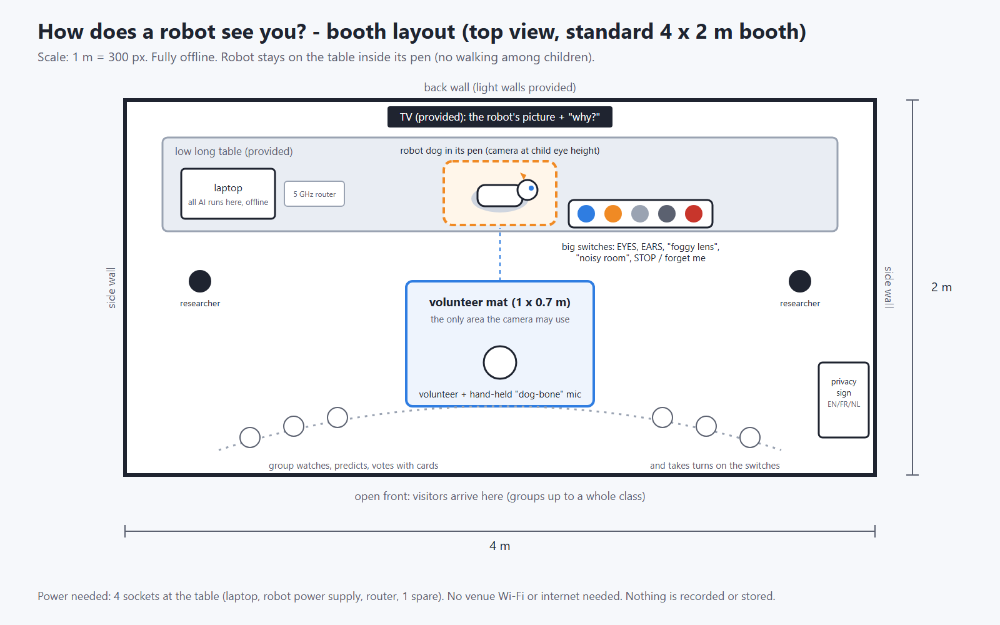

# 06 - Exhibition walkthrough, demonstration scenario and educational value

Purpose: describe exactly what happens at the "How does a robot see you?" booth (layout, 15-minute group module, one volunteer round, robot script, learning goals, staffing, fallback, safety) so partners can check it and we can reuse it for form field B2 ("How do you plan on presenting your research?", max 3,000 characters), the B5 booth sketch, and the safety and requirements list after selection (research/01 §1.6).

## The 3-minute volunteer round in one page

One child stands on the mat holding the "dog-bone" microphone (the robot's "ears"). Two classmates work the switches; everyone else predicts with vote cards before every flip. Times are design values (details §3, script §5).

1. **Ready (0:00-0:15).** Robot: "Please step onto my mat. I only look at the mat, nowhere else." Child: steps on, presses a language flag, answers the host: "May the robot see you? May it hear you?" Screen: all senses OFF, an avatar full of "?".
2. **Eyes on (0:15-0:40).** After the child's yes, EYES goes on and the lens shutter opens. Seeing exactly one person on the mat, the robot wags its tail: "My eyes are on. I see one person on my mat." Screen: a pixelated view of the mat; clothes colour, glasses and "how much is happening right now" appear with blue eye badges and certainty words.
3. **Ears on, question 1 (0:40-1:10).** Robot: "My ears are on. I only listen when my light turns orange. What is your favourite animal?" Child: says "dog" into the bone, or shows the dog card. Robot: "I'm sure your favourite animal is a DOG. Because my ears heard the animal's name in what you said." Screen: "I heard: dog" (only the matched word); the dog appears with an orange ear badge, "you told me".
4. **Question 2 (1:10-1:30).** Robot: "What is your favourite colour?" Child: "Green." Screen: favourite colour changes from a weak guess from the clothes to GREEN; the clue balance shows a small blue weight against a big orange one.
5. **Check (1:30-1:50).** Robot: "Was I right? Thumbs up or thumbs down!" If wrong: "Sorry, I was wrong." Everyone: thumbs. Screen: a "why" card for each answer.
6. **Take a sense away (1:50-2:25).** After the group predicts, operators flip EYES off, on again, then EARS off. Robot: "OK, my eyes are off. Now I can only use what my ears hear." Screen: clothes colour and glasses fade to "?".
7. **Trouble or fool (2:25-2:45).** Round 1: FOGGY LENS. Round 2: cat card while saying "dog", then NOISY ROOM. Round 3: child's choice (§4). Robot (Round 2): "My senses disagree: my eyes say CAT but my ears say DOG. For this question I trust my ears more." Screen: certainty words drop; a "My senses disagree" card appears.
8. **Forget me (2:45-3:00).** Robot: "Remember: I am a computer program. ... I never guess who you are, how you feel, your age or where you come from." Child: presses red. Robot: "Done. My memory is empty." Screen: the evidence list is shredded; the avatar returns to "?".

A "no" to a sense means a round without it, with no comment. Hard cap: 4 minutes.

## 15-minute group module at a glance

1. **0:00-2:00 Hook.** "How do you recognise a friend? Which senses do you use?" The robot says it is a computer program, that its senses stay off until allowed, and that it forgets you. Vote cards go out.
2. **2:00-5:00 Round 1, "Meet my senses".** The round above, with FOGGY LENS as the trouble switch.
3. **5:20-8:20 Round 2, "Fool the robot".** Cat card while saying "dog", then NOISY ROOM with the whole group as noise makers.
4. **8:40-12:00 Round 3, "Your choice" (optional).** Absorbs overrun; for large or late groups, the paper "Be the robot" balance game instead (§8).
5. **12:00-14:00 Reveal.** Group totals and a recorded demo session: which sense helped most, when the robot was sure but wrong, "Things I will never guess, and why". Optional "robot's imagination": the robot's own cartoon redrawn as a robot mascot from words it believes, never from the camera, labelled AI-generated.
6. **14:00-15:00 Forget me.** Countdown, red button, visible wipe, take-home sentence. Then about 1 min changeover.

---

**Operations manual.** Everything below is the detailed reference for staff and partners. Status 2026-10-02. Source of truth: `docs/_brief.md`. File references point to `research/` and `prototype/`. Values marked "design value" are our choices to tune in rehearsal. Values marked "to confirm" are not yet verified. The round is the planned design: today the screen, fusion and explanations run on recorded visitors, and live mode is tested on recordings only (`prototype/README.md`; docs/08 §11).

## Key points

- **One child on the mat, two on the switches, everyone else predicts with vote cards and makes "noise" on cue.** That gives 6-9 hands-on children per group and 2-3 mat volunteers. Our estimate is 45-60 group slots over the fair's 16 public hours.
- **A round never starts by itself.** Staff start it and the volunteer steps onto the mat. H asks "May the robot see you? May it hear you?", and a switch operator presses EYES or EARS (green ON light) only for a sense the volunteer said yes to. The laptop then accepts exactly one person who stays inside the mat region for more than 1.5 s facing the robot. The robot never speaks to passers-by.
- **The improved round** keeps the original 7-stage scenario but changes six things. Senses start off and are switched on one at a time, only after the volunteer's yes. The picture and its explanation update live. The group predicts before every switch flip. A "fool the robot" moment shows the robot being confidently wrong. The round ends with a visible wipe. By default nothing goes home (optional printed card: no photo, no name, no QR code).
- **Robot script:** 16 core lines (L1-L15 and L8w) plus 4 repair lines in EN/FR/NL. The first line is the AI disclosure. Switching a sense off gets a neutral reply, never guilt.
- **The 7 learning concepts plus "never guess"** are each tied to a specific moment in the round, with age layers 7-10 / 11-14 / 15-18 and links to biology, maths, privacy rights and AI4K12 Big Ideas 1 (Perception) and 2 (Representation & Reasoning).
- **Fallback ladder:** hot-spare robot, then laptop camera, then an unpowered "be the robot" balance game that teaches the same lesson.
- **Safety:** the robot sits in a pen and only gestures. Visitors never touch it. The e-stop is on the staff side. At least 2 staff are always present, and a teacher must be at the booth for camera/mic rounds. No photos of pupils. No battery charging in the visitor area. Staff vetting (sex-offender register, KRK and foreign criminal records) starts in January 2027.

---

## 1. The booth at a glance

A visitor approaching the open front of the standard 4 x 2 m booth sees:

| Element | Where | What it is for |
|---|---|---|
| TV (provided by the fair) | Back wall, above the table | Shows **"the robot's picture"** of the volunteer plus the "why" cards (layout below). When idle it shows the title and a looping recorded demo, never a live camera. |
| Robot dog (SunFounder PiDog V2) in its pen | Centre of the low table, camera at child eye height | Sits, stands, tilts its head, wags its tail, lights its LED bar and speaks. It does not walk. It is a thin sensor node: all AI runs on the laptop (brief §4). |
| Big switches | Table, right of the robot | EYES (blue), EARS (orange), FOGGY LENS (light grey), NOISY ROOM (dark grey) and STOP / forget me (red), as in the sketch. Each sense switch has a green ON light. To add: EN/FR/NL flag buttons (see Open items). |
| Laptop and 5 GHz router | Table, left (staff side) | All AI, offline, with no venue Wi-Fi. The staff keypad (round start, skip, abort) and the e-stop sit here, out of visitors' reach. |
| Volunteer mat, 1 x 0.7 m | Floor in front of the robot | The only area the camera may analyse. One volunteer holds the hand-held "dog-bone" close-talk microphone, which is the robot's "ears". |
| Group area | Open front, arc behind the mat | The group watches, predicts with vote cards and takes turns on the switches. |
| Privacy sign EN/FR/NL | Front corner | First-layer notice with pictograms. Base text in research/09 §10, adapted to our switches (EYES blue, EARS orange) and our 6 slots (clothes colour, glasses, favourite animal and colour you tell it, how much is happening right now, voice right now). The research/09 draft mentions a green button, distance and waves, which do not apply to this design. |
| Card printer (optional) | Table, right | Offline. Prints a card with no photo and no name. |

**What the TV shows during a round** (from brief §1 and §5, prototype `robotsees/xai.py`):
- **Sensor bar (top):** EYES ON/OFF, EARS ON/OFF, FOGGY, NOISY, current language. A sense that is off shows "no data from my eyes since 10:03:15".
- **The robot's picture (centre):** a cartoon avatar in which every element is one of the 6 slots (favourite animal, favourite colour, clothes colour, glasses, "how much is happening right now", "voice right now"). A sharp element means sure, faded or dashed means unsure, and "?" means it does not know. A badge shows which sense found it: blue eye or orange ear. Answers the child said are marked "you told me", and things the robot observed are marked "I noticed".
- **"Why" cards:** evidence cards with a time stamp ("my ears heard you say 'dog'", "my eyes measured the colours of the pixels on your top"), plus certainty words: *I'm sure / I think / I'm guessing / I don't know yet* (`robotsees/config.py`).
- **Clue balance**, one slot at a time: blue and orange weights; the tilt shows what it believes.
- **What-if strip:** 4 mini avatars (eyes + ears, eyes only, ears only, none), computed live.
- **Robot's-eye view:** a small corner showing a pixelated view of the mat only, with the boxes the robot used. Never raw video.
- **"Things I will never guess, and why"** panel at the bottom.

Not in the sketch yet, but needed: flag buttons, a staff-side e-stop, a box of props (vote cards, 12 animal picture cards matching the robot's vocabulary, fun glasses), the unpowered fallback kit (§8), and a touchable replica dog at the front (cardboard or 3D-printed, not the hot spare) for children who want to touch "the robot". The replica follows the Museum of Science, Boston pattern: Spot behind a fence, with a touchable replica outside (research/10 §2.2).

---

## 2. The 15-minute group module

Staff roles (details in §7): **H** = host, **O** = robot operator, **F** = floor facilitator, **LA** = SiW language assistant (provided by the organisers).

| Time | Segment | What happens | Rest of the group | Staff |
|---|---|---|---|---|
| 0:00-0:30 | Arrival | F greets the teacher, asks them to stay at the booth, and asks which pupils must not be on camera; those pupils take no-camera roles (research/09 §10). The group stands in an arc behind the mat. | Each child (or pair) takes vote cards | F, LA |
| 0:30-1:15 | Hook | H: "How do you recognise a friend in the playground? Which senses do you use?" Then: "This robot has senses too. This camera is its eyes. This bone is its ears." | Answer out loud | H, LA translates |
| 1:15-2:00 | Robot introduces itself | O starts group mode and selects the language flag. The robot says L1 and L2 (AI disclosure, privacy promise). H shows the switches and the red button. Volunteer 1 and two switch operators step forward, volunteers only. | Learn the vote cards | O, H |
| 2:00-5:00 | Round 1: "Meet my senses" | Full round (§3.3): the volunteer says yes or no to each sense, eyes on, ears on, 2 questions, why cards, "Was I right?", group flips EYES off and EARS off, FOGGY LENS, forget me. | Predict before each flip; 2 pupils on switches | all |
| 5:00-5:20 | Handover | Round 1 data is already wiped. Next volunteer and switch operators step forward. | | F |
| 5:20-8:20 | Round 2: "Fool the robot" | After the volunteer's yes to each sense, a quick eyes + ears start, then the cat card while saying "dog" (§4, V1), then NOISY ROOM with the group as noise makers. Forget me. | Vote "EYES or EARS: which sense will win?"; make noise on cue | all |
| 8:20-8:40 | Handover | | | F |
| 8:40-12:00 | Round 3: "Your choice" (optional) | The volunteer picks one variant from §4 (fun glasses, whisper vs shout, cover the lens, stand far away). Round 3 data is wiped at the end of the round like the others. This slot also absorbs any overrun from Rounds 1-2. | Predict; 2 pupils on switches | all |
| 12:00-14:00 | Reveal and discuss | No volunteer's data is left. The reveal uses aggregate group results (e.g. "right 5 of 8 times; most mistakes with the eyes off") and a recorded demo session, on which the clue balance shows what each sense contributed (research/10 §8.2). Discuss when the robot was wrong and why, and compare predictions with results (show of hands). Show "Things I will never guess, and why". Optional "robot's imagination" on the demo session: an image generator (LCM-Dreamshaper v7) restyles the robot's own avatar drawing into a cartoon *robot* mascot, using only closed-vocabulary words the robot believes ("I'm guessing" or higher). It never sees the camera image and never draws a human likeness. It is labelled AI-generated on screen, with the words it got, and carries machine-readable AI marking (IPTC and EXIF; AI Act Art. 50(2)). Pre-rendered for the 6 recorded visitors; live mode does not generate it yet (brief §1, change 2; docs/08 §11). Opinion question: "Should robots be allowed to use cameras in schools?" (research/10 §8.0) | Hands up; older pupils explain the balance | H |
| 14:00-15:00 | Forget me | The whole group counts down 3-2-1 and the last volunteer presses red: L15 plays, the group results go into a shredder animation and the avatar goes blank. H gives the take-home sentence. Optional printed cards (printed at the end of each round, before its wipe) are handed out. | Count down together | H, O |
| 15:00-16:00 | Changeover (not group time) | The robot lies down (servos relaxed), the bone and props are wiped, the battery is checked and the next group is pre-briefed. | | O, F |

**Take-home sentence (H, translated by LA):** "The robot does not know you. It builds a picture from clues. You decide which senses it may use. It must explain itself, say when it is unsure, and some things it must never guess." (brief §1; research/01 §5.3)

**Short version** for large or late groups, or when another group is waiting: drop Round 3 and run the paper balance game (§8) with everyone from 8:40. All children get hands-on time, and the robot rests.

**How the rest of the group takes part:**
- **Prediction vote cards.** Each child or pair has two double-sided cards: *SURE / NOT SURE* and *EYES / EARS*. Before every reveal or switch flip, H asks a prediction question ("If we switch the eyes off, will it still be sure about the clothes colour?") and everyone holds up a side. H reads the room, then the flip happens. This keeps 20 or more children active while 3 operate (research/10 §8.3, pattern 12).
- **Switch operators.** Two per round stand at the switch box and flip only when H calls "3-2-1, flip!". They switch a sense on only after the volunteer has said yes to it (§3.2). This prevents button mashing; the software also debounces. The red STOP / forget me button belongs to the volunteer. The e-stop is not on this box.
- **"Noisy room" makers.** On H's signal the whole group claps and talks for 3-5 s, then stops when H raises a hand. Held 3-10 cm from the mouth, the bone picks up about 20-26 dB more speech, relative to the hall noise, than a mic 1 m away (inverse-square estimate, research/10 §4.1-4.2). So real noise often does not defeat the robot, which is a lesson in itself. The NOISY ROOM switch then mixes recorded crowd babble into the ears' signal at 0 dB SNR, the condition we tested (brief §6), so the effect shows every time.
- **Everyone:** thumbs up or down on "Was I right?". Younger children point at the badge (eye or ear) that found each thing.

---

## 3. One volunteer round (about 3 min)

### 3.1 What changed from the original 7-stage scenario

| Original stage | Improved round | Why |
|---|---|---|
| 1 Meet the robot | Done once for the whole group (L1, L2). Each round adds only the mat invitation (L3) and a reminder near the end (L14). | Saves time per round. The AI disclosure still comes before any sensing and is repeated, because the Art. 50 guidelines say periodic reminders are likely to be necessary where children interact (C(2026) 5054, para. 40; research/09 §4.5). |
| 2 Sensor selection | All senses start OFF. The volunteer says yes or no to each sense; the allowed senses are switched on one at a time, EYES first, then EARS. | Children see what each sense adds ("unveil gradually", research/07 §8.2). Off by default is also a privacy control (brief §7), and the volunteer's own yes is the opt-in and the easy way to object (research/09 §3.3). |
| 3 Interaction | Two closed questions (favourite animal, favourite colour), answered into the bone or, for the animal, with a picture card. Listen window of 5 s or less. | Free conversation is unreliable in a noisy hall and unsafe with children (brief §1, change 4; research/10 §3.2). |
| 4 Representation | Shown live from the first clue, not as a separate stage. | Watching the picture change as clues arrive is the lesson. |
| 5 Explanation | "Why" cards and the clue balance for the slot just answered, then "Was I right?". | Inviting correction counters children's over-trust in robots (research/10 §3.2). |
| 6 Sensor manipulation | The group predicts first, then the operators flip. Trouble switches and a "fool the robot" moment are added. | Predict-then-flip turns spectators into participants and tests whether the explanation was understood (research/07 §8.2). |
| 7 Final result | No portrait, no QR code. A visible "forget me" wipe, plus an optional card with no photo and no name. | Nothing about the child leaves the booth (brief §1, change 6). |

### 3.2 Start, engagement, duration, end

**How it starts (never automatically in the crowd).**
1. O presses ROUND START on the staff keypad. The volunteer presses their language flag.
2. The volunteer steps onto the mat holding the bone.
3. **The volunteer decides.** H asks: "May the robot see you? May it hear you?" A sense is switched on only after the volunteer's own yes to it, either by a switch operator or by the volunteer pressing it. A no to one sense means a round without that sense; a no to both means the child steps back. Neither staff nor the robot comments on a no. This keeps the opt-in with the child, not with classmates (research/09 §3.3 and §10 item 3; "teacher or peer pressure to take part" is on the DPIA risk list, research/09 §12 item 4).
4. After a yes to EYES, EYES is pressed. The green light comes on, the physical lens shutter opens and the Pi starts capturing.
5. **Engagement check.** The laptop accepts the volunteer only when exactly one person is detected inside the mat region for **more than 1.5 s, facing the robot** (MediaPipe face detector and pose, brief §4). Until then no evidence is stored, and the screen says "Waiting for one person on my mat".
6. The robot wags its tail and says L4.

After the yes, switch operators handle only switching senses OFF, the trouble switches and switching back on a sense the volunteer already allowed. They never switch on a sense the volunteer refused.

If the volunteer does not want the camera, the round runs with EARS only. The engagement signal is then the robot's question plus the answer spoken into the bone.

The 1.5 s threshold is a design value to tune on site. research/10 §1.2 suggests frontal (within ±30° yaw), near and stable for at least 1 s as a starting point. In a field system, the conservative trigger "large, close, frontal face after entering the group formation" had 0.18% false positives (6 of 3,274 face tracks; Bohus & Horvitz 2009, research/10 §1.1). The same paper names a push-to-engage button as the model conservative start, which supports our staff-started round.

**How the system knows who is interacting.**
- **Explicit start by staff.** There is no auto-start, and the robot never speaks to passers-by. A building-lobby robot (CMU's Roboceptionist) aimed 66% of its head turns at people who were only passing, and 54% of its greetings got no response (research/10 §1.1). When idle, the robot plays a scripted doze animation with all senses off.
- **Region of interest.** Frames are cropped to the mat and everything else is blacked out before any model sees them (research/09 §9, control 4). Bystanders are never analysed.
- **One person only.** If two people stand in the mat region, evidence pauses and the robot says R4.
- **Ears.** The robot listens only in a window of 5 s or less after its own question. During that window its LED bar is orange and it sits still, so servo noise stays out of the audio (brief §1, change 7). Silero VAD passes only speech to the recogniser. The transcript exists only in RAM for the current audio chunk and is discarded at once; only matched closed-vocabulary words reach the evidence ledger (`prototype/robotsees/session.py` `perceive_audio`; `prototype/live/run_live.py`).
- **Leaving the mat** pauses evidence collection immediately.

**Duration.** About 3 min. The step table in §3.3 fits the 3:00 that Rounds 1 and 2 get in §2; Round 3 has up to 3:20 and absorbs any overrun. Hard cap of 4 min per round (design value); after that the robot closes the round itself.

**How it ends.**

| Trigger | What happens |
|---|---|
| Volunteer presses red STOP / forget me (normal end, or at any time) | L15 plays, the wipe animation runs, the evidence ledger in RAM is cleared, and all senses return to OFF. |
| Volunteer leaves the mat | Evidence pauses at once. After about 10 s the robot says R3. After about 30 s it auto-forgets with the same animation (research/10 §1.2: prompt at 8-10 s, forget at 25-30 s). |
| 4-min cap reached | The robot says L14 and L15, then wipes. |
| Staff ABORT key | Immediate wipe, for example if a child is upset or for safeguarding reasons. |
| E-stop (staff side) | All servos relax and the UI freezes. The session is wiped before restart. |

**What the visitor receives.** By default, nothing except the experience and the visible forgetting. Optionally, before the wipe, an offline printed card showing:
- which senses they allowed (icons);
- 3-4 guesses with certainty words, and whether they confirmed each one;
- "Things I will never guess";
- the TUAI and MSCA logos and, if wanted, a short printed web address that is the same for everyone (**to confirm**).

The card carries no photo, no name, no timestamp and no QR code (brief §1, change 6; research/09 §0 item 9 and §11). A per-visitor QR code would also exclude many pupils: in Flanders 59% of primary-school children have no smartphone (research/10 §0 item 10). Printer options with US prices are in research/10 §7; EU prices are to confirm. SiW does not pay for giveaways (research/01 §1.8).

### 3.3 The round step by step

Robot lines are quoted in EN. FR/NL versions and line numbers are in §5. T1/T2 are template sentences generated from the evidence ledger (`robotsees/xai.py`).

| Step (time) | Robot says | Volunteer does | Screen shows | What is learned |
|---|---|---|---|---|
| 1 Ready (0:00-0:15) | L3: "Please step onto my mat. I only look at the mat, nowhere else." | Steps onto the mat with the bone and presses a flag. Answers H: "May the robot see you? May it hear you?" | All sense icons OFF; blank avatar full of "?"; "I know nothing about you yet." | AI only uses the information it receives. You decide which senses it gets. |
| 2 Eyes on (0:15-0:40) | L4: "My eyes are on. I see one person on my mat. I wag my tail when I find a person." | Stands facing the robot. After the volunteer's yes, EYES was pressed. | Robot's-eye view of the mat (pixelated, boxes on head and top). Clothes colour, glasses and "how much is happening right now" appear with blue eye badges and certainty words. | Eyes give some kinds of information (colour, glasses, movement) but not others. |
| 3 Ears on, question 1 (0:40-1:10) | L5: "My ears are on. I only listen when my light turns orange." L6: "What is your favourite animal? Say it into the bone, or show me a picture card." Then T1, e.g. "I'm sure your favourite animal is a DOG. Because my ears heard the animal's name in what you said." | Says "dog" into the bone, or holds up the dog card. | "I heard: dog" (the matched word only). The animal appears with an orange ear badge, marked "you told me". A voice-level meter is shown. | Ears give different information. "Data you give" is not the same as "data it notices". |
| 4 Question 2 (1:10-1:30) | L7: "What is your favourite colour? Say it into the bone." Then T1. | Says, e.g., "green". | Favourite colour switches from the eyes' weak hint (clothes colour; relevance 0.35, brief §1) to GREEN. The clue balance shows a small blue weight against a big orange one. | Combining senses changes the result. A strong clue outweighs a weak one. |
| 5 Why and check (1:30-1:50) | L8: "Was I right? Thumbs up or thumbs down!" If wrong: L8w: "Sorry, I was wrong. My eyes were fooled. Thank you for telling me." | Thumbs up or down; the group joins in. | "Why" cards for each answer. | Explanations show the evidence. AI can be wrong and should say so. |
| 6 Take a sense away (1:50-2:25) | L9 or L10 on each flip, plus T2: "I can't tell: my eyes are switched off." | Watches while the group predicts and the operators flip EYES off, back on, then EARS off. | Clothes colour and glasses fade to "?". With ears off, the favourite colour falls back to a weak guess from clothes or to "I don't know yet". The what-if strip highlights the current setting. | Removing information changes conclusions, and the robot does not pretend otherwise. |
| 7 Trouble or fool (2:25-2:45) | L11 (foggy lens), L12 (noisy room) or L13 (senses disagree). | One variant from §4. | Certainty words drop; a "My senses disagree" card appears. | Inference is not certainty. Noise in the ears makes the robot unsure rather than wrong; a foggy lens can also make it wrong, because clothes look darker (brief §6). |
| 8 End (2:45-3:00) | L14: reminder plus "never guess". L15: forget me. | Presses red. | The ledger empties (shredder animation) and the avatar returns to "?". | You control your data, and the forgetting is visible. |

Round 1 uses FOGGY LENS in step 7. Round 2 uses the cat/dog conflict plus NOISY ROOM. Round 3 uses the volunteer's choice.

Step times are design values to check in rehearsal. They add up to the 3:00 given to Rounds 1 and 2 in §2. Round 3 (8:40-12:00) absorbs any overrun; if Rounds 1-2 run long, Round 3 is shortened or dropped as in the short version (§2).

---

## 4. "Fool the robot" variants

Expected behaviour follows from the fusion design in brief §5. Each variant must be checked in rehearsal before we promise it on stage.

| Variant | How | Expected robot behaviour | Lesson | Notes |
|---|---|---|---|---|
| **V1 Show a cat card, say "dog"** | The volunteer holds the cat card at chest height and says "dog" into the bone. | The eyes (picture card, moderate clue) say CAT; the ears (spoken word, strong clue) say DOG. The fused answer is DOG, with L13 ("My senses disagree...") and a lower certainty word. When EARS go off, the answer flips to CAT. | Sensors can conflict. Combining them changes the result, and the robot weighs senses differently for each question. | The group votes EYES or EARS first. This is the brief's core "fool" moment. |
| **V2 Fun glasses** | The volunteer puts on prop glasses for about 10 s, then takes them off. | The glasses slot changes only after several frames, because each frame is a small clue (brief §5). After the glasses come off, old and new clues disagree, so the robot is less sure. Novelty glasses may not be recognised at all. | Evidence builds up over time. The robot matches patterns it was tuned on (photos of adults; glasses AUROC 0.914, brief §6). | Wipe props between groups. The robot never draws any conclusion about eyesight (research/09 §8, #10a). |
| **V3 Cover the lens** | Compare (a) a staff member holding a card over the lens with (b) the operator switching EYES off, which closes the shutter. | (a) The camera is on but finds no person, so it adds no new clues. (b) The eyes' term is left out completely: "my eyes are switched off". | Bad data is different from missing data. A missing sense is left out, not treated as darkness (brief §5: missing sensor = term omitted). | Visitors never touch the robot or its lens. |
| **V4 Whisper vs shout** | The volunteer answers once in a whisper and once loudly. | "Voice right now" moves from quiet to loud, measured against the booth calibration. A whisper may be missed, giving R1 and then "I don't know yet". | Readings are momentary ("right now"), not traits. A quieter answer is weaker evidence. | The robot never says "you are loud" or "angry" (research/09 §8, #12). Keep shouting short. |
| **V5 Stand far away** | (a) Hold the bone at arm's length while the group makes noise. (b) Step off the mat for a few seconds. | (a) Words are missed, and the robot says "I don't know yet" rather than guessing wrong. In our tests at 0 dB babble, 72.9% of colour words were missed and 0.5% were wrong (brief §6, Lombard GRID). (b) The robot stops looking at once and says R3 after about 10 s. | Distance weakens evidence. The mat is the robot's only window, which is privacy by design. | Step back on within about 30 s, or the round wipes. |

For 15-18-year-olds at the reveal, add a real failure from our prototype. Visitor B's favourite colour became "brown" (sure) because she said "ginger brown" about her rabbit. Keyword spotting does not understand meaning, so at the booth words count only as answers to the robot's own question (brief §6).

---

## 5. Robot script (EN, FR, NL)

FR and NL are drafts: **to be checked by a native speaker** (Belgian French, Flemish Dutch). The fixed lines L1-R4 are pre-rendered with Piper TTS on the laptop (brief §4) and played on the robot's speaker. The template sentences T1/T2 (below) are either pre-rendered for every combination (12 animals, 11 colours, 4 certainty words, 2 senses, per language; `robotsees/config.py`) or synthesised live at about 1.4 s per sentence (measured, brief §4). Decide in rehearsal. Group lines use plural "you" (vous / jullie); volunteer lines use singular (tu / je).

**Core lines**

| # | When | EN | FR (to be checked by a native speaker) | NL (to be checked by a native speaker) |
|---|---|---|---|---|
| L1 | Group intro: AI disclosure (AI Act Art. 50(1)) | Hello! I am a robot dog: a machine run by a computer program. I am not alive and I have no feelings. | Bonjour ! Je suis un chien robot : une machine qui fonctionne avec un programme d'ordinateur. Je ne suis pas vivant et je n'ai pas de sentiments. | Hallo! Ik ben een robothond: een machine die werkt met een computerprogramma. Ik leef niet en ik heb geen gevoelens. |
| L2 | Group intro: privacy promise | My eyes and ears are off. You decide if I may use them. I only guess, I save nothing, and at the end I forget you. | Mes yeux et mes oreilles sont éteints. C'est vous qui décidez si je peux les utiliser. Je ne fais que deviner, je n'enregistre rien et, à la fin, je vous oublie. | Mijn ogen en oren staan uit. Jullie beslissen of ik ze mag gebruiken. Ik raad alleen maar, ik bewaar niets en op het einde vergeet ik jullie. |
| L3 | Round start | Please step onto my mat. I only look at the mat, nowhere else. | Monte sur mon tapis, s'il te plaît. Je regarde seulement le tapis, nulle part ailleurs. | Kom op mijn mat staan, alsjeblieft. Ik kijk alleen naar de mat, nergens anders. |
| L4 | EYES on and engagement check passed | My eyes are on. I see one person on my mat. I wag my tail when I find a person. | Mes yeux sont allumés. Je vois une personne sur mon tapis. Je remue la queue quand je trouve une personne. | Mijn ogen staan aan. Ik zie één persoon op mijn mat. Ik kwispel als ik een persoon vind. |
| L5 | EARS on | My ears are on. I only listen when my light turns orange. | Mes oreilles sont allumées. J'écoute seulement quand ma lumière devient orange. | Mijn oren staan aan. Ik luister alleen als mijn lampje oranje wordt. |
| L6 | Question 1 | What is your favourite animal? Say it into the bone, or show me a picture card. | Quel est ton animal préféré ? Dis-le dans l'os, ou montre-moi une carte. | Wat is je lievelingsdier? Zeg het in het bot, of laat me een kaartje zien. |
| L7 | Question 2 | What is your favourite colour? Say it into the bone. | Quelle est ta couleur préférée ? Dis-la dans l'os. | Wat is je lievelingskleur? Zeg het in het bot. |
| L8 | Check | Was I right? Thumbs up or thumbs down! | Est-ce que j'avais raison ? Pouce en l'air ou pouce en bas ! | Had ik gelijk? Duim omhoog of duim omlaag! |
| L8w | If wrong (brief apology, research/10 §3.2) | Sorry, I was wrong. My eyes were fooled. Thank you for telling me. *(or "my ears")* | Pardon, je me suis trompé. Mes yeux se sont fait piéger. Merci de me l'avoir dit. *(ou « mes oreilles »)* | Sorry, ik had het mis. Mijn ogen werden beetgenomen. Bedankt dat je het me zegt. *(of "mijn oren")* |
| L9 | EYES switched off (neutral) | OK, my eyes are off. Now I can only use what my ears hear. | D'accord, mes yeux sont éteints. Maintenant, je peux seulement utiliser ce que mes oreilles entendent. | Oké, mijn ogen staan uit. Nu kan ik alleen gebruiken wat mijn oren horen. |
| L10 | EARS switched off (neutral) | OK, my ears are off. Now I can only use what my eyes see. | D'accord, mes oreilles sont éteintes. Maintenant, je peux seulement utiliser ce que mes yeux voient. | Oké, mijn oren staan uit. Nu kan ik alleen gebruiken wat mijn ogen zien. |
| L11 | FOGGY LENS on | My lens is foggy. I see less clearly, so I am less sure. | Mon objectif est embué. Je vois moins bien, alors je suis moins sûr. | Mijn lens is beslagen. Ik zie minder goed, dus ik ben minder zeker. |
| L12 | NOISY ROOM on | It is very noisy. If I can't hear your words, I will say "I don't know" instead of guessing. | Il y a beaucoup de bruit. Si je n'entends pas tes mots, je dirai « je ne sais pas » au lieu de deviner. | Het is heel lawaaierig. Als ik je woorden niet hoor, zeg ik "ik weet het niet" in plaats van te gokken. |
| L13 | Senses disagree (template, example values) | My senses disagree: my eyes say CAT but my ears say DOG. For this question I trust my ears more. | Mes sens ne sont pas d'accord : mes yeux disent CHAT, mais mes oreilles disent CHIEN. Pour cette question, je fais plus confiance à mes oreilles. | Mijn zintuigen zijn het niet eens: mijn ogen zeggen KAT, maar mijn oren zeggen HOND. Voor deze vraag vertrouw ik mijn oren meer. |
| L14 | Reminder near the end (periodic reminder, Art. 50 guidelines para. 40) and "never guess" | Remember: I am a computer program, and you can stop me with the red button. I never guess who you are, how you feel, your age or where you come from. | Rappel : je suis un programme d'ordinateur, et tu peux m'arrêter avec le bouton rouge. Je ne devine jamais qui tu es, ce que tu ressens, ton âge ni d'où tu viens. | Denk eraan: ik ben een computerprogramma, en je kunt me stoppen met de rode knop. Ik raad nooit wie je bent, hoe je je voelt, hoe oud je bent of waar je vandaan komt. |
| L15 | Forget me | Press the red button and I will forget everything about you. ... Done. My memory is empty. | Appuie sur le bouton rouge et j'oublie tout sur toi. ... Voilà, ma mémoire est vide. | Druk op de rode knop en ik vergeet alles over jou. ... Klaar, mijn geheugen is leeg. |

**Repair lines**

| # | When | EN | FR (to be checked by a native speaker) | NL (to be checked by a native speaker) |
|---|---|---|---|---|
| R1 | First missed answer | I didn't catch that. Try holding the bone close to your mouth. | Je n'ai pas bien entendu. Essaie de tenir l'os tout près de ta bouche. | Dat heb ik niet goed gehoord. Hou het bot eens dicht bij je mond. |
| R2 | Second missed answer, or the child stays silent | That's OK, you don't have to answer. Then I will say: I don't know yet. | Pas de souci, tu n'as pas besoin de répondre. Alors je dirai : je ne sais pas encore. | Dat is oké, je hoeft niet te antwoorden. Dan zeg ik: ik weet het nog niet. |
| R3 | Mat empty for about 10 s | I see nobody on my mat. Step back onto it if you want to continue. | Je ne vois personne sur mon tapis. Remonte dessus si tu veux continuer. | Ik zie niemand op mijn mat. Ga er weer op staan als je verder wilt doen. |
| R4 | Two people in the mat region | I can only look at one person at a time. One person on the mat, please. | Je ne peux regarder qu'une seule personne à la fois. Une seule personne sur le tapis, s'il vous plaît. | Ik kan maar naar één persoon tegelijk kijken. Eén persoon op de mat, alstublieft. |

**Template sentences.** These are built at runtime from the ledger, with no LLM (`robotsees/xai.py`, EN only so far):
- T1: "{I'm sure / I think / I'm guessing} {your favourite animal is a DOG}. Because my {ears} {heard the animal's name in what you said}."
- T2: "I can't tell: my {eyes} are switched off."

The FR/NL templates still have to be written. FR needs an article per word (un chien, une tortue).

**Script rules** (research/09 §4.7, §10, §15; research/10 §3.2):
- Switching a sense off gets a neutral reply (L9, L10), never sadness or pleading.
- No feelings claims, no flattery, no "I like you".
- No comments on appearance, behaviour or silence.
- Never ask for a name, age, school or feelings.
- Dog behaviours are explained as signals (L4: the tail wag means "I found a person").

---

## 6. Educational value

### 6.1 The 7 concepts, and where a child experiences each one

| # | Concept | Moment (§3.3, §4) | What the child experiences |
|---|---|---|---|
| 1 | AI only sees available information | Step 1 (all off: "I know nothing about you yet"); V5b (step off the mat) | A blank avatar; the robot stops looking the moment you leave its window. |
| 2 | Different sensors give different information | Steps 2-3 | Blue badges for clothes, glasses and movement; orange badges for words and voice. Glasses only the eyes can know; voice only the ears can know. |
| 3 | Combining sensors changes the result | Step 4 (favourite colour: clothes hint vs spoken word); V1 | The answer changes when the second sense joins. In our ablation (6 recorded visitors, clean condition), eyes + ears knew 4.5 of 6 things per visitor on average, eyes only 2.3 and ears only 1.8; 94% of the 17 checkable eyes + ears claims were correct (`prototype/experiments/results/ablation_table.md`; brief §6). |
| 4 | Inference is not certainty | Step 7 (foggy lens, noisy room); certainty words throughout | The avatar fades, the robot says "I'm guessing", and in noise it says "I don't know" instead of a wrong answer. |
| 5 | AI makes mistakes | Step 5 ("Was I right?"); step 7 (foggy lens); V1, V2 | The robot is confidently wrong when fooled, says so and apologises. Through the foggy lens, clothes look darker and the eyes can name the wrong colour: in our tests eyes-only claims were then 25% correct (brief §6). |
| 6 | Explanations show evidence | Steps 4-5 (why cards, clue balance); reveal | Each answer shows which sense pushed it and how hard. For older pupils, the clues add up exactly to the score (brief §5). |
| 7 | Removing information changes conclusions | Step 6; what-if strip; V3 | Predict, flip, and watch the answer and the certainty change. |
| + | Some things it must never guess | L14 at step 8; "never guess" panel at the reveal | "Things I will never guess, and why", for example who you are, how you feel, your age or gender, where you come from, your health (the 5 entries now in `robotsees/config.py`). The full never-inferred list is in brief §1 (it also covers ethnicity or skin tone, hair colour, height or body shape, accent or native language, headwear, personality and attention); the panel should cover it in child language. For older pupils: hat detection was built and then removed after the ethics review, because headwear can reveal religion (brief §1). |

### 6.2 Age layers (brief §2; research/01 §5.4)

| | 7-10 | 11-14 | 15-18 |
|---|---|---|---|
| Typical role | Switch operator, noise maker, vote cards; volunteer if they want | Volunteer; fool-the-robot challenge | Volunteer; explains the balance to the group |
| What they look at | The avatar, eye and ear badges, sharp vs faded | Clue balance, certainty words, why cards | Clue values: score = prior + each sense's clue (log-odds). Switching a sense off removes exactly its clue, which equals its Shapley value (brief §5). |
| Numbers | None. No percentages for children (research/07 §6). | Counts as illustration only ("7 out of 10 robots would say glasses", research/07 §7) | Our measurements (brief §6): "I'm sure" glasses claims were 92.8% correct; colour words were heard correctly 79.7% of the time in quiet and 26.6% in heavy babble, with only 0.5% wrong. |
| Extra topic | "Robots have senses like us, but different." | "Data you give vs data it notices"; why a robot can be fooled | Bias: commercial gender classifiers erred up to 34.7% for darker-skinned women vs 0.8% for lighter-skinned men (Gender Shades, research/10 §6). Also the AI Act (Art. 5 prohibitions, Art. 50 disclosure), why we removed hats, and Visitor B's "ginger brown". |

### 6.3 Links to school and AI-literacy frameworks

The call asks proposals to "take school knowledge to the next level" (research/01 §1.2). The booth starts from the senses children know and ends with sensor fusion, uncertainty, explanation and data rights.

| Area | Link | Moment |
|---|---|---|
| Biology: senses | Eyes and ears vs camera and microphone. People combine senses to recognise a friend. | Hook; steps 2-3 |
| Maths: probability | "How sure?", weighing clues, certainty words. At 15-18: logarithms and adding log-odds. | Clue balance; reveal |
| Physics (older pupils) | Sound level and distance; lenses and light | V4, V5, FOGGY LENS |
| Citizenship / digital literacy: privacy rights | You decide which senses it may use, you can say no, it forgets you, and it must tell you it is an AI. | L1-L2, red button, L14 |
| **AI4K12 Big Idea 1: Perception** | EYES/EARS switches, the mat as the only window, foggy lens, noisy room | Steps 2-3, 6-7 |
| **AI4K12 Big Idea 2: Representation & Reasoning** | The avatar is a belief over 6 slots, built by weighing evidence | Steps 4-6, reveal |

Big Idea titles are verified (research/07 [72], https://ai4k12.org/). The booth also covers four of Long & Magerko's AI-literacy competencies: Sensors, Representations, AI Strengths & Weaknesses, and Ethics (research/07 §6). Specific references to the FWB and Flemish curricula are **to confirm** with a Belgian teacher.

### 6.4 Research at the core (research/01 §3.3)

| Booth moment | PhD research it shows |
|---|---|
| A sense is switched off; the robot keeps working but is less sure | DC5: "fault-tolerant operation even if individual sensors fail" |
| Cat card vs "dog": "My senses disagree" | DC5: "identifying cases of uncertainty or conflicting data" |
| Why cards and clue balance | DC7: AI that can "articulate their decisions" |
| "Never guess" panel, bias discussion | DC7: "highlighting any inherent biases" |

---

## 7. Throughput, staffing, queues, special cases, languages

### 7.1 Throughput (our estimate)

| Quantity | Value | Basis |
|---|---|---|
| Group slot | 15 min, plus about 1 min changeover | SiW call (research/01 §1.2); research/10 §2.2 |
| Slots per hour | 3.75 at 100% use; about 2.8 at 75% | 75% is research/10's planning assumption (resets, battery, breaks) |
| Mat volunteers | 2-3 per slot, so 7.5-11 per hour at 100% or 5.6-8.4 per hour at 75% | Our calculation |
| Hands-on children (volunteer + 2 switch operators per round) | 6-9 per slot, so about 17-34 per hour | Our calculation |
| Public hours | 16 (17 Mar 9-13 h; 18-19 Mar 9-15 h) | research/01 §0 |
| Whole fair | 45-60 slots; about 90-180 mat volunteers; about 270-540 hands-on children | Our calculation |
| Pupils reached | About 540-900 if groups average 12-15 pupils | Group size from research/01 §2, which is that file's own estimate (**to confirm**) |

As a benchmark, Galaxy Makers (Royal Society Summer Science Exhibition) reached about 10 hands-on users per hour per machine (research/10 §2.1). The number of groups per booth per day is **to confirm** with the organisers.

### 7.2 Staffing (3 people; the EC funds up to 3)

| Role | Where | Does |
|---|---|---|
| H, host | Front, beside the group | Hook, prediction questions, "3-2-1 flip", reveal, take-home sentence. Speaks EN; the LA translates. |
| O, robot operator | Staff side of the table (laptop, keypad, e-stop) | Starts rounds and language, watches the mat and the robot, uses skip/abort and the e-stop. Never leaves the robot powered and unattended. |
| F, floor facilitator | Group edge and queue | Teacher check, vote cards, coaching volunteers and switch operators, wiping props, the next group, the fallback game. |

- At least 2 staff are present at all times (research/10 §5.2), and the booth must always be staffed (call, research/01 §1.2). Breaks are staggered.
- With only 2 staff, H also covers F's tasks, and the waiting group gets the balance game only between slots.
- **Language assistant:** SiW provides them (30 interpreters in 2026, research/01 §2). Whether one is dedicated to our booth is **to confirm** (research/10 §11). Give them a one-page script with L1, L2, the hook questions and the take-home sentence.
- Recruit an FR or NL speaker as the third person if possible (research/01 §5.8).

### 7.3 Queue handling (research/10 §2.2)

- **A group arrives during a slot:** F welcomes them and hands out vote cards. F either explains the switches ("you will decide which senses the robot gets") or starts the paper balance game (§8) at the side. Newcomers do not join a round midway; visitors avoid joining strangers mid-activity (FROG, research/10 §1.1). A sign or TV corner shows "next group starts in 0:40".
- **More than 2 groups waiting:** switch to the short version (2 rounds plus the balance game).
- **Families or individuals in quiet periods:** one 4-min solo round, or a 90-s express version (honesty line, eyes on, eyes off, forget) (research/10 §8.1).
- The **touchable replica** at the front absorbs the urge to touch the real robot.

### 7.4 Very young or shy children

- 7-8-year-olds start as switch operators or noise makers and become volunteers only if they want to.
- **Non-verbal path:** show an animal card instead of speaking. For the colour question, silence is fine: the robot says R2, then "I don't know yet", which is itself the lesson about missing information.
- An EYES-only or EARS-only round is allowed. A pupil who must not be on camera can be a switch operator, or hold the bone in an EARS-only round.
- A friend may stand beside the mat, outside the region, and the teacher may volunteer instead.
- After two missed answers the robot moves on without blame (research/10 §3.2). The robot never comments on appearance, behaviour or silence.
- If a child looks upset, O uses ABORT (immediate wipe) and H checks in with the teacher.

### 7.5 Languages

- **Flag buttons (EN / FR / NL)** are set per group and can be changed per volunteer. Automatic language ID identified English only 85% of the time even on short English test sentences (brief §6), and guessing a child's language from their accent is on our "avoid" list (research/09 §8, #7).
- The fixed robot lines are pre-rendered per language with Piper TTS, so they play without delay. The T1/T2 templates are either pre-rendered for every combination or synthesised live at about 1.4 s per sentence (measured, brief §4); see §5. Keyword spotting covers EN/FR/NL/DE/PL (brief §1). The FR/NL voice quality is **to confirm**.
- Screen text follows the flag, and icons carry the meaning for everyone else.
- In mixed FR/NL groups, the robot speaks the volunteer's language and the LA summarises for the others.

---

## 8. Unpowered fallback: "Be the robot" balance game

**Fallback ladder** (in this order):
1. The robot fails: swap in the hot-spare PiDog. We plan 2 units (brief §3). Swap time is to measure in rehearsal.
2. Both robots fail: use the laptop camera as "eyes" and the bone as "ears". The live runner already accepts a laptop webcam (`prototype/live/run_live.py --camera 0`), so far tested on recordings only (`prototype/README.md`). The dog stays on the table unpowered, and we say plainly that "its eyes are now this camera".
3. The laptop fails: run the paper balance game below. Printed A3 screenshots of a recorded demo session (eyes + ears / eyes only / ears only) replace the TV.

**The balance game** (research/01 §6 recommends an unpowered fallback of this kind; research/10 §8.0 describes the "Be the robot" game):

| Item | Content |
|---|---|
| Kit | A3 laminated balance boards, one per question (favourite animal, favourite colour), with a seesaw and two pans labelled with candidate answers (e.g. DOG / CAT, or GREEN / BLUE). Blue (eyes) and orange (ears) tokens in three sizes, matching the robot's clue strengths (brief §1): big = strong clue (a word said), medium = moderate clue (a picture card shown), small = weak clue (a clothes-colour hint for the favourite colour, relevance 0.35). EYES and EARS role cards, FOGGY LENS and NOISY ROOM trouble cards, the 12 animal picture cards, a strip of certainty words, the "Things I will never guess" card, and a sheet of tracing paper. |
| Roles | One "visitor" (chooses an animal card and what to say). Two "eyes" (may only look). Two "ears" (turn around and may only listen). Everyone else forms the "fusion team", which places tokens and reads the tilt. |
| Play (5-8 min) | 1. The visitor shows the cat card and says "dog". The eyes put a medium blue token on CAT; the ears put a big orange token on DOG. The balance tips to DOG, but not fully: "I think DOG. My senses disagree." On the colour board, the eyes can only add a small token from the clothes colour, and a colour word said outweighs it. 2. Take away a sense: remove all orange tokens and the balance falls back to CAT. 3. FOGGY LENS: the eyes look through the tracing paper and may place only small tokens. NOISY ROOM: the class claps while the visitor whispers, and the ears place a token only if they are sure. "I don't know" is allowed. 4. Explain: which tokens made it tip? 5. Never guess: which tokens would tell us someone's feelings or age? None we may use, so there is no pan for them. 6. Forget me: sweep all tokens off the board. |
| Same lessons | All 7 concepts and "never guess". At 15-18 the tokens are log-odds units, and adding them is the real fusion rule (brief §5). |

The game also keeps a waiting group busy (§7.3) and gives a whole class hands-on time when the robot rests.

---

## 9. Safety and safeguarding rules at the booth

| Rule | Source |
|---|---|
| The robot stays in its pen on the table and only gestures (sit, stand, head tilt, tail, paw lift). It never walks during the fair. | Brief §1 change 5; research/10 §5.2 |
| Hands off: visitors interact through the bone, switches and screen only. Only staff handle the robot, and only when it is at rest. Sign: "I'm a machine, please don't touch my legs." Quadruped joints can pinch. | research/10 §5.1-5.2 |
| The e-stop is a physical button on the staff side that relaxes all servos and freezes the UI. It is never within visitors' reach (museum visitors liked pressing e-stops) and is tested at every set-up. | research/10 §1.1 (FROG), §5.2 |
| Servos rest at every changeover and during the reveal: 2-3 min of rest every 20 min or so. Check the temperature at battery swaps. The PiDog has hobby-grade servos and HAT (open GitHub issues), so keep the hot spare ready. | research/10 §5.2; research/02 §2.1 |
| Battery: 7.4 V 2000 mAh 2x18650 pack, claimed 90-120 min in one review; runtime with a Pi 5 is to measure (a review advised against a Pi 5 on PiDog battery power). No charging in the public booth area. Swap packs, and charge them away from visitors, attended, in a fire-safe bag, only where the venue allows (**to confirm** with the organisers). Running tethered on USB-C charges the installed pack (Robot HAT V5 charges over USB-C), so it falls under the same rule: use it only if the organisers accept it (`docs/03_hardware.md`, "Tethered power"). Spare packs: availability **to confirm**. | research/02 §2.1 and §4; research/09 §14 item 12, §15; research/10 §5.2 |
| No cables on the visitor side; tape everything down. Wipe the bone, picture cards and fun glasses between groups. | research/10 §5.2 |
| At least 2 staff at all times. Never one adult alone with one child. A staff member always stands beside the robot, because unattended children mistreat public robots, more often in larger groups and longer sessions. | research/09 §9 item 22; research/10 §0 item 9 and verifier note 4 |
| A teacher (or parent) must be present for camera or microphone rounds; children without an accompanying adult get no-camera roles. Ask on arrival which pupils must not be on camera. | research/09 §10 |
| Taking part is voluntary ("Just watch, or ask us!"). Each sense goes on only after the volunteer's own yes (§3.2). There is no pressure from staff and no guilt from the robot. | research/09 §3.3, §4.7 (AI Act Art. 5(1)(b)), §10 |
| No photos or videos of identifiable pupils, and no staff phones filming children. Document the booth empty, staff only, or the screen with abstract output only. | research/09 §3.6; SUT Order 50/2024 |
| Vetting for every staff member and any helper we bring: a Polish Register of Sex Offenders check plus KRK criminal-record information, and, for anyone with foreign citizenship or foreign residence in the last 20 years, a foreign criminal-record certificate (or a sworn statement where that country issues none). Request foreign certificates in January 2027, because they can take weeks. File the SUT HR request (Order 37/2024 as amended by 240/2024) no later than 9 Mar 2027 (7 days before set-up). Effect of the 5 Aug 2025 amending Act: **to confirm** with HR. Brief all staff on SUT's child-protection standards. | research/09 §0 item 11, §9 item 23, §12 (verifier corrections: Art. 21 of the 2016 Act; MoJ FAQ https://www.gov.pl/web/sprawiedliwosc/pytania-do-ustawy-o-ochronie-dzieci2); SUT Orders 37/2024 (amended by 240/2024) and 50/2024 |
| If a child says something worrying, nothing is stored and the robot ignores it, because it only knows its closed vocabulary. A staff member tells the accompanying teacher and follows SUT's child-protection standards. The escalation path is **to confirm** with SUT. | research/09 §6 (children may tell robots secrets), §12 item 10 |
| Data at the booth: laptop offline, nothing written to disk, cloud sync and screen recorders off. No per-session logs; daily aggregate counters only. A data incident is reported to the SUT DPO. | research/09 §9 items 7, 12-13, 24 |
| The TV never shows raw video: only a pixelated view of the mat. Bystanders outside the mat are never analysed. | research/09 §9 items 4, 15 |
| Signs: the first-layer EN/FR/NL sign at the front (research/09 §10 text adapted to our switches and 6 slots, see §1), an A4 "for grown-ups" sheet, and a teacher information sheet sent through the organisers before the fair. | research/09 §10 |
| Plan B, if the SUT DPO requires guardian consent for camera processing: camera rounds only for pupils whose teacher confirms the school holds a consent slip; everyone else takes no-camera roles. Decide by November 2026. | research/09 §3.3, §10 |
| "Noisy room" moments last 3-5 s, on cue. SiW rules on noise and amplification are **to confirm**. | research/10 §4.1, §11 |
| Incident log: time, what happened, action taken. No child names. | research/10 §5.2; research/09 §3.4 (minimisation) |

---

## Open items

- **Booth sketch update:** add the EN/FR/NL flag buttons, the staff-side e-stop, the props box, the fallback kit and the touchable replica (`docs/assets/booth_sketch.png` shows the five big switches but not these). Its power line lists a "robot power supply" socket at the table: that means tethered USB-C operation, which charges the installed pack in the pen. Keep it only if the organisers accept charging there (see §9, battery row).
- **Foggy lens can mislead:** in our tests it made the eyes name darker clothes colours (brief §6). Decide in rehearsal whether to show this as a lesson or add a stronger image-quality gate first (docs/04_methodology.md). L11 ("so I am less sure") may then need rewording.
- **Robot's imagination:** pre-rendered for the 6 recorded visitors only; live mode does not generate it yet. It stays optional, and the booth must work without it (docs/04_methodology.md).
- **Live mode:** tested on recordings only. Test it with a real webcam, then with the PiDog stream.
- **Engagement threshold** (1.5 s, facing the robot) and the mat-region framing for the smallest and tallest pupils: tune in rehearsal.
- **Wireless close-talk mic:** check whether the chosen model has a mute or push-to-talk switch. Check also that the listen-window design works with its latency.
- **FR/NL:** native-speaker check of all lines; write the FR/NL templates (T1/T2); check Piper FR/NL voice quality.
- **Rehearse V1-V5** and confirm the expected behaviour, especially novelty glasses and the covered lens.
- **Organisers (after 28 Oct 2026):** groups per booth per day, noise rules, battery and charging rules (including tethered operation), whether a language assistant is dedicated to our booth, photo rules, and whether the teacher sheet can go in the school pack.
- **SUT:** DPO decision on Plan A or Plan B; the safeguarding escalation path; staff vetting (register check, KRK, foreign criminal-record certificates requested in January 2027; HR request filed by 9 Mar 2027 at the latest; effect of the 5 Aug 2025 amending Act to confirm with HR).
- **Battery and charging:** measure Pi 5 runtime on the PiDog pack; confirm spare-pack availability; ask the organisers whether tethered operation (which charges the pack) and attended charging away from visitors are allowed.
- **Printed card:** whether to add a short web address that is the same for everyone (no QR code in any case).
- **Belgian curriculum references** (FWB, Flemish) for §6.3.
- **Printer choice and EU price** (research/10 §7 has US prices only), if we decide to offer the optional card.

## Sources

- Brief: `docs/_brief.md`. Prototype: `prototype/README.md`, `prototype/robotsees/config.py`, `xai.py`, `session.py`, `render/imagination.py`, `prototype/live/run_live.py`, `prototype/experiments/build_imagination.py`, `prototype/experiments/results/ablation_table.md`.
- research/01 (call, TUAI): SiW 2027 call https://marie-sklodowska-curie-actions.ec.europa.eu/node/1621 ; application form https://ec.europa.eu/eusurvey/runner/Call_SiW2027
- research/02 (robots): PiDog docs https://docs.sunfounder.com/projects/pidog/en/latest/ ; Robot HAT V5 (charges the pack over USB-C) https://docs.sunfounder.com/projects/robot-hat-v4/en/latest/robot_hat_v5/hardware_introduction.html ; Raspberry Pi magazine review (Pi 5 battery strain) https://magazine.raspberrypi.com/articles/pidog-robot-review
- research/07 (XAI): AI4K12 https://ai4k12.org/ ; Long & Magerko, CHI 2020 https://dl.acm.org/doi/10.1145/3313831.3376727
- research/09 (ethics, law): Art. 50 guidelines C(2026) 5054 https://ec.europa.eu/newsroom/dae/redirection/document/131215 ; AI Act Art. 5 https://artificialintelligenceact.eu/article/5/ ; SUT Order 50/2024 https://bip.polsl.pl/wp-content/uploads/sites/4/2024/07/M.2024.260.Z.50.pdf ; SUT Order 240/2024 https://bip.polsl.pl/wp-content/uploads/sites/4/2024/12/M.2024.1463.Z.240.pdf ; Ministry of Justice FAQ on the child-protection Act (KRK and foreign records) https://www.gov.pl/web/sprawiedliwosc/pytania-do-ustawy-o-ochronie-dzieci2
- research/10 (HRI, prior art): Bohus & Horvitz 2009 http://erichorvitz.com/Bohus_Horvitz_Predict_Engagement.pdf ; Michalowski et al. 2006 https://publications.ri.cmu.edu/storage/publications/pub_files/pub4/michalowski_marek_piotr_2006_3/michalowski_marek_piotr_2006_3.pdf ; Brščić et al. 2015 https://www.irc.atr.jp/~drazen/pdf/HRI2015_Brscic.pdf ; Karreman et al. 2015 (FROG) https://www.cs.kent.ac.uk/events/2015/AISB2015/proceedings/hri/7-Karreman-howcana.pdf ; Galaxy Makers https://arxiv.org/abs/1705.04563 ; Gender Shades https://proceedings.mlr.press/v81/buolamwini18a.html ; Apestaartjaren 2024 (smartphone ownership, Flanders) https://assets.mediawijs.be/2024-05/apenstaartjarenrapport_2024_lr_1_3.pdf ; Museum of Science, Boston *Exploring AI* https://www.mos.org/visit/exhibits/exploring-ai-making-invisible-visible
